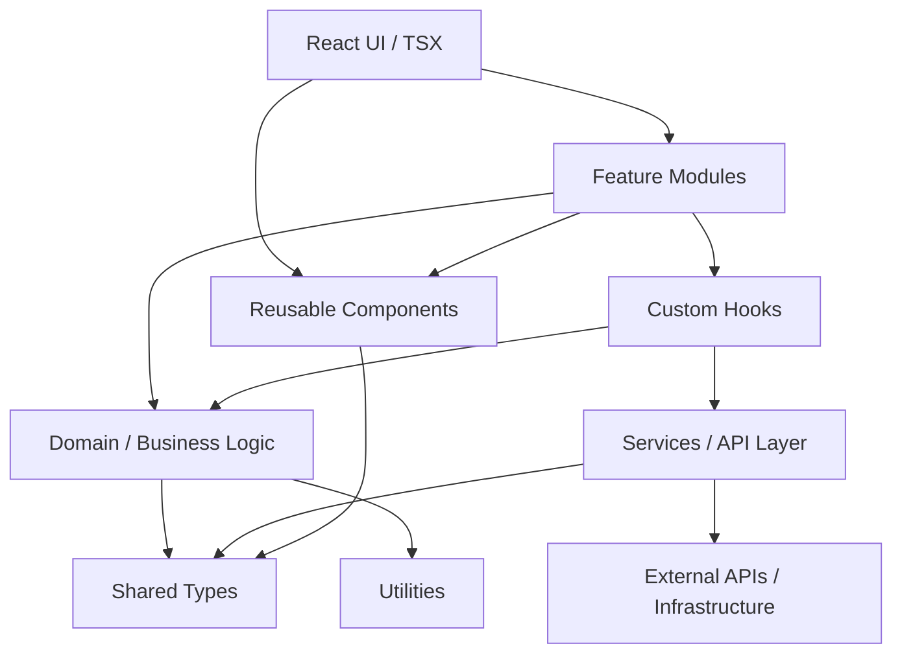
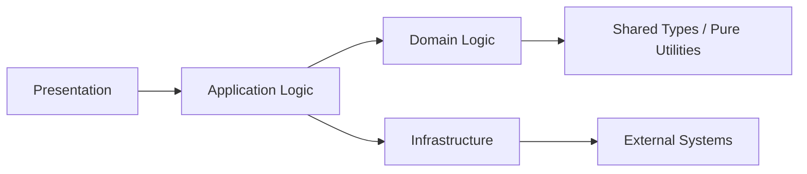
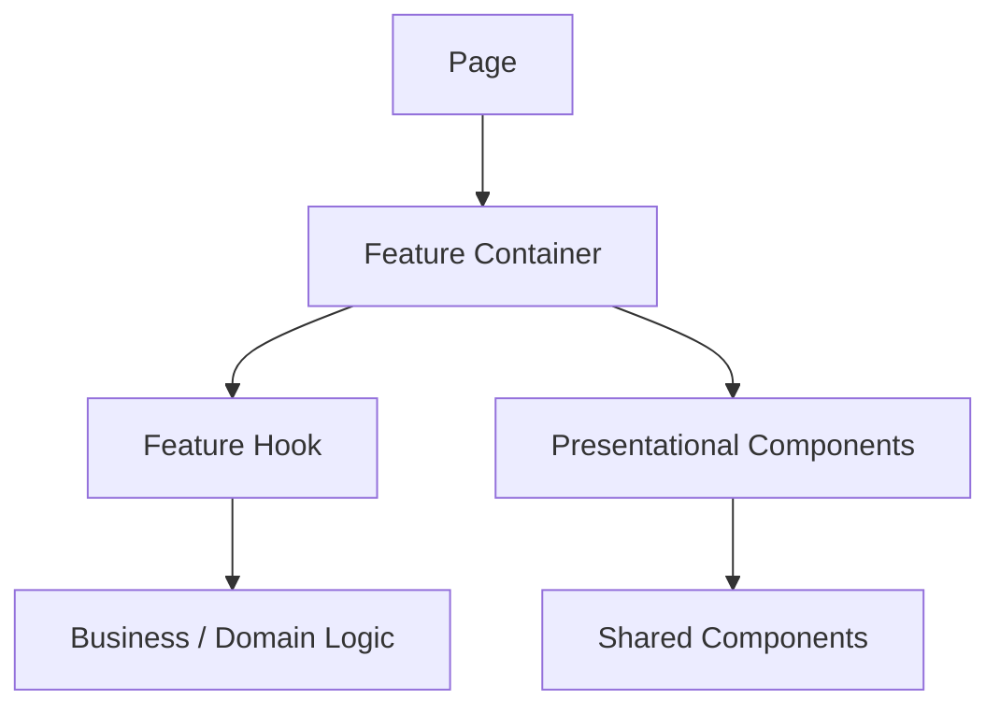
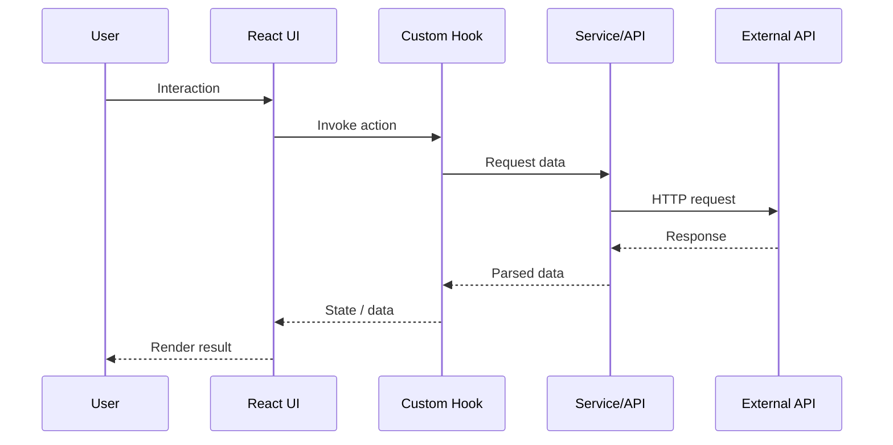
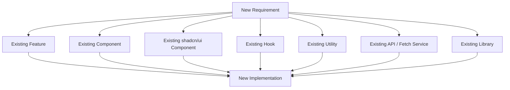

# Source Architecture Map

This document describes the high-level architecture and important source-code relationships of this application.

Update this document when significant architectural changes are introduced.

---

## High-Level Architecture



---

## Architectural Rules



The dependency direction should generally follow:

```text
Presentation
      ↓
Application
      ↓
Domain
      ↓
Shared
```

Infrastructure should remain at the boundary.

## Profile Image Storage Flow

`frontend/src/pages/profile/index.tsx` requests an upload URL from
`src/uploads/routes/Routes.py`. `UploadController` validates the request and
persists object metadata through `ImageAsset`, while `StorjStorage` creates a
short-lived S3-compatible pre-signed URL using backend-only credentials. The
browser sends the image bytes directly to Storj; the authenticated completion
endpoint verifies the stored object before selecting it as the user's profile
image. Profile reads return the configured public URL or a fresh signed GET
URL.

## Gallery Access Flow

The public `/gallary` page fetches paginated gallery items and requests more
when its scroll sentinel becomes visible. The public gallery API returns free
image URLs to anyone. Premium image URLs are returned only when the request
has a valid session with an active subscription; their signed GET lifetime is
bounded by the remaining subscription time. Otherwise the UI renders a locked,
blurred placeholder without exposing the source URL. Admin gallery management
uses the authenticated `/admin/gallery` routes to upload directly to Storj,
toggle premium status, paginate, and selectively or bulk delete images.

## OAuth Authentication Flow

The login and registration pages share `OAuthButtons` and navigate to the
backend provider-start endpoint. The auth routes delegate to `OAuthService`,
which redirects to Google or Facebook with a random state value stored in an
HTTP-only cookie. On callback, the service validates state, exchanges the
authorization code server-side, fetches provider identity/email, creates or
finds a normal `User`, persists provider identifiers in `OAuthIdentity`, and
sets the same HTTP-only access-token cookie used by password login. Provider
client secrets remain backend-only.

---

## Feature Structure

Use the project's existing structure.

When a feature is sufficiently complex, prefer a domain-oriented structure such as:

```text
features/
└── users/
    ├── components/
    ├── hooks/
    ├── services/
    ├── utils/
    ├── types.ts
    └── index.ts
```

Do not create this structure for every small feature automatically.

---

## Component Relationship



---

## Data Flow



---

## Reuse Hierarchy

When implementing functionality, prefer:



The goal is:

```text
Reuse
  >
Extend
  >
Compose
  >
Create
```

---

## Important Architectural Decisions

Record significant decisions here.

Example:

```text
ADR-001
Decision: Use the project's existing fetch abstraction for all API calls.
Reason: Centralizes authentication, error handling, and request configuration.
```

---

## Updating This Map

Update this document when:

* a new major feature is introduced
* a new architectural layer is introduced
* dependency direction changes
* a major shared component system changes
* API/data-access architecture changes
* state-management architecture changes

Do not update it for every small component or file.

The map should remain useful to engineers and AI agents trying to understand the system.
